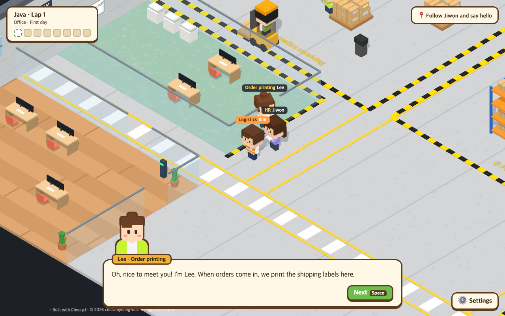
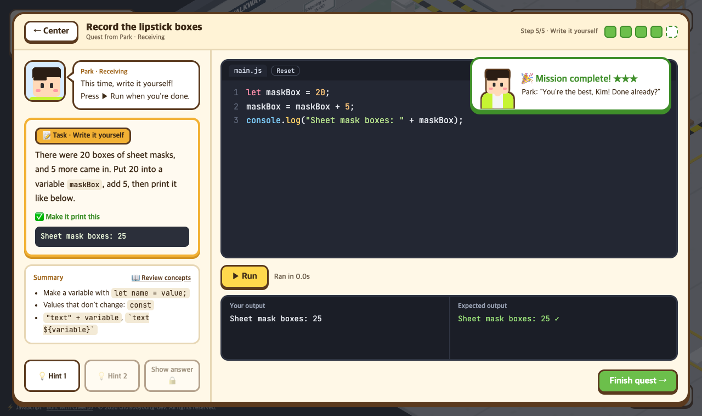
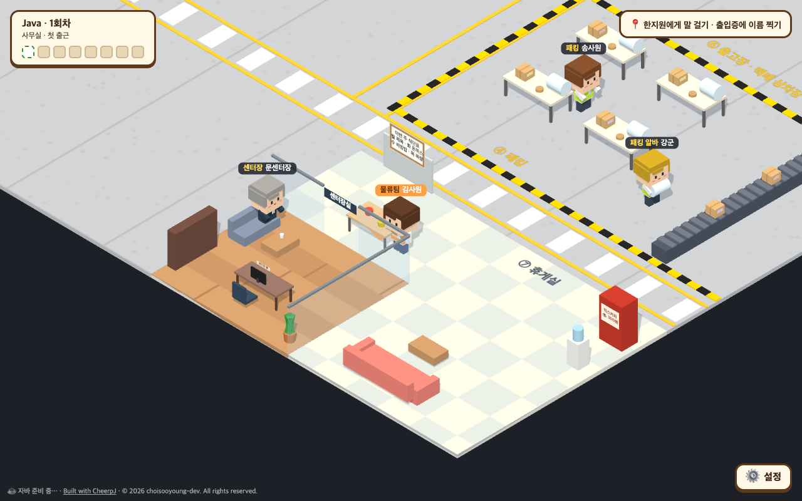

<div align="center">

# cotudy

### Clock in at a logistics center. Get the work done in code.

A 3D game for learning **Java · JavaScript · Python**

[**▶ Play now**](https://choisooyoung-dev.github.io/cotudy/) &nbsp;·&nbsp; [한국어](README.md)

No install, no sign-up &nbsp;|&nbsp; Runs in your browser &nbsp;|&nbsp; Free



</div>

---

## What it is

You're **Kim**, the newest hire on the logistics team at a cosmetics fulfillment center. The receiving lead needs boxes counted, and the forklift driver wants a load calculator.
Solve your coworkers' requests **in code**, and step by step you'll use a language from its basics up to the features people use at work every day.

<table>
<tr>
<td width="50%"></td>
<td width="50%"></td>
</tr>
<tr>
<td align="center">Your code is run and graded on its output</td>
<td align="center">A 3D center to walk around, full of coworkers</td>
</tr>
</table>

## Features

- **Starts with a job interview** &nbsp; About 10 questions in the HQ meeting room. What you already know is skipped, and your work starts with what you don't. The result arrives as an offer email.
- **Graded by running your code** &nbsp; Your code runs in the browser and is graded on the output it prints.
- **Four steps** &nbsp; Read the concept → predict the output → fill in the blanks → write it yourself. Friendly for first-time coders.
- **From basics to everyday features** &nbsp; 39 concepts per language: 29 basics (output, variables, conditions, loops, arrays, functions, classes…) and 10 advanced ones for that language.
- **HQ coding tests** &nbsp; A week after your first day, three HQ staff (easy, medium, hard) start taking turns visiting with a problem. Missed problems and the interview questions can be tried again on the break room retry board.
- **Errors in plain words** &nbsp; When something breaks, you're told which line and why, in plain language.
- **Several characters** &nbsp; Make a separate character for each language and start from day one. Progress is saved per character.
- **A lively center** &nbsp; Coworkers take breaks in the break room now and then, and you can drive a parked forklift yourself.
- **Plays on phones too** &nbsp; Hold and drag on the floor to walk, tap a person or thing to use it, and "Go there" takes you right next to whoever you need.
- **English / 한국어** &nbsp; Dialogue, quests and even the text inside the code switch language.
- **Pick up anywhere** &nbsp; Progress saves in your browser automatically, and a save file moves it to another computer.

## What you'll learn

Lap 1 is one topic per area of the center, the same for all three languages.

| # | Area | Who asks | What you learn |
|:-:|---|---|---|
| 1 | Office | Jiwon (HR) | Printing, reading error messages, comments |
| 2 | Cosmetics receiving | Park | Variables, number / boolean / string types, conversion |
| 3 | Order printing | Lee | Arithmetic and remainder, comparison and logic |
| 4 | Picking | Jung | if / else if, combined conditions, string comparison, switch · match |
| 5 | Packing | Song | for, while, break / continue, nested loops |
| 6 | Shipping | Oh | Arrays and lists, max and counting, growing lists |
| 7 | Courier loading | Mr. Yoon | Slicing, finding, replacing and splitting strings, formatting |
| 8 | Forklift lane | Choi | Methods and functions, parameters, return values |
| 9 | Packing bench | Kang | Maps and dictionaries (key-value), counting |
| 10 | Director's office | Director Moon | Classes and objects, error handling, review |

After that, 10 advanced concepts per language.

| Language | Advanced concepts |
|---|---|
| Java (21) | Encapsulation, inheritance, interfaces, static, enum, generics, collections, lambdas, streams, custom exceptions |
| JavaScript | Scope, closures, callbacks, map · filter, reduce · sort, destructuring · spread, JSON, inheritance, Promise, async / await |
| Python | Comprehensions, lambda · sorted, enumerate · zip, function arguments (*args · **kwargs), closures, decorators, generators, inheritance, special methods, custom exceptions · with |

## How to play

1. A new character starts with the HQ interview. Pick the language and answer what you can. New to coding? You can choose to start from the basics.
2. Once the offer email arrives, go to work! Follow Jiwon around the center and say hello to the team.
3. Go to anyone with a red **!** over their head and talk to them to hear their request.
4. Write code in the mission window and press ▶ Run. Matching output means success. Fewer hints, more stars.

| | Computer | Phone |
|---|---|---|
| Walk | Arrow keys or WASD | Hold and drag on the floor (tap to go there) |
| Talk · use things | `Enter` or `Space` | Tap the person or thing, or the button at the bottom right |
| Dialogue choices | Arrow keys, then `Enter` · `Space` | Tap a button |

> **Java needs a moment the first time.** The browser has to download the program that runs Java, so the first time takes about 10–40 seconds. Concept examples show their output right away meanwhile, and later visits are quick.

---

## Copyright

© 2026 choisooyoung-dev. All rights reserved.

You're free to play and learn with it. Copying, modifying, redistributing or using the code, quest content, characters, dialogue or visual design commercially without permission is not allowed. If there's something you'd like to use, please ask in an issue first.
See [LICENSE](LICENSE), and [THIRD_PARTY_NOTICES.md](THIRD_PARTY_NOTICES.md) for the licenses of the bundled third-party software (CheerpJ, Pyodide, Three.js and others).

<details>
<summary><b>For developers: running it locally and how the code is organized</b></summary>

Requires Node.js 20 or later.

```bash
git clone https://github.com/choisooyoung-dev/cotudy.git
cd cotudy
npm install
npm run dev
```

Opens at http://localhost:5180. Pushing to `main` deploys to GitHub Pages through GitHub Actions.
Format the code with `npm run format` (Prettier, 4-space indent).

**Code layout**

- `src/main.js` game flow: dialogue, quests, first-day tour, job interview, HQ visits, retry board, settings
- `src/world/` the Three.js center, characters, camera and how people move around
- `src/ui/mission.js` the mission window · `src/ui/hire.js` the job interview and offer email
- `src/runner/` runners: CheerpJ (Java 21) for Java, Pyodide for Python, a Web Worker for JavaScript
- `src/store.js` saving (per character, per language)
- `src/content/<language>/` quest data. `quests.js` · `quests.en.js` cover areas 1–2, `more.js` areas 3–10, `advanced.js` the advanced concepts, `interview.js` the interview questions, `hq.js` the HQ problems
- `src/content/stages.js`, `npcs.js`, `tour.js` stage order, characters, first-day tour
- `src/i18n.js` display language; on-screen text is written as `tr('한국어', 'English')`
- `public/java-frame.html` the hidden frame that runs Java. CheerpJ's javac stops on the 68th compile in one page, so the frame is replaced every 50 compiles
- `src/content/outputs.json` pre-run results of the Java and Python examples and solutions; the same code shows this result instead of running

**After editing quests**

```bash
node scripts/precompute-outputs.mjs        # rebuild the pre-run results (with npm run dev running)
node scripts/daily-check.mjs http://localhost:5180/   # run every quest's code and compare with the expected output
```

Add quests to all three languages with the same `id`, `stage` and `npc`. The solution code must print exactly `expected`, and explanations use only that language's terms.
While developing, open a quest from the browser console with e.g. `cotudy.startQuest(cotudy.current.java[0])`.

</details>
