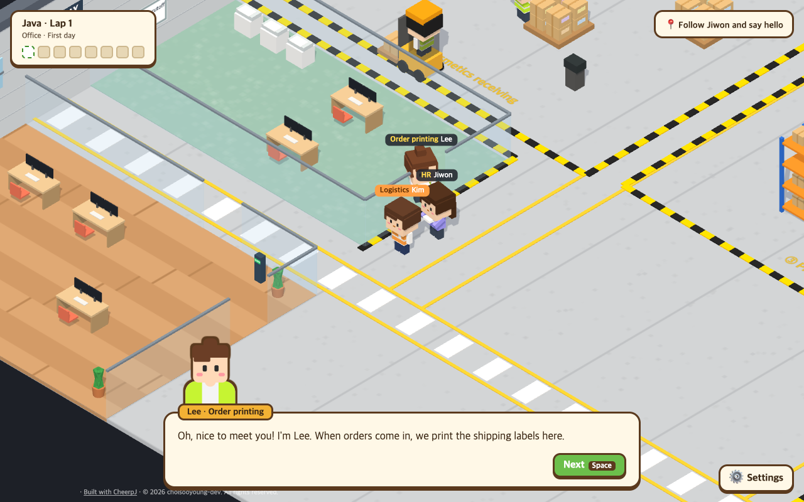
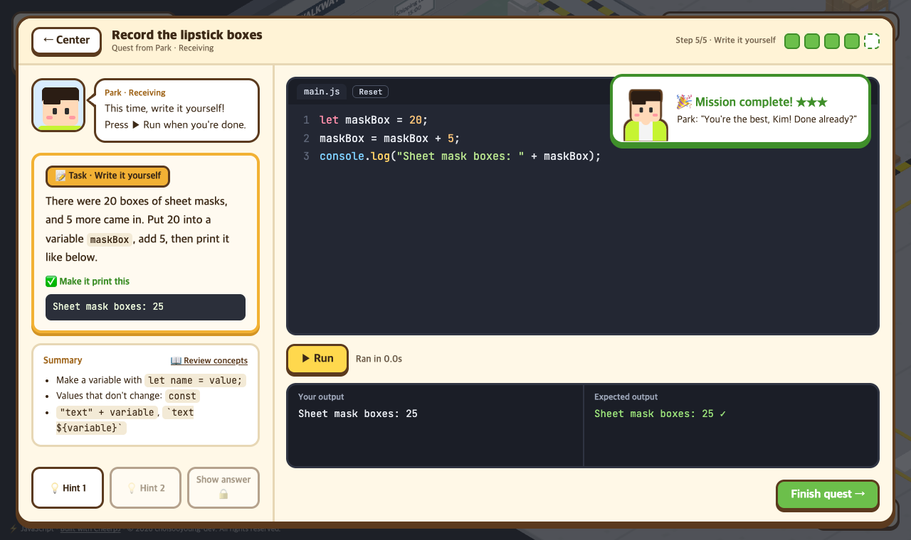
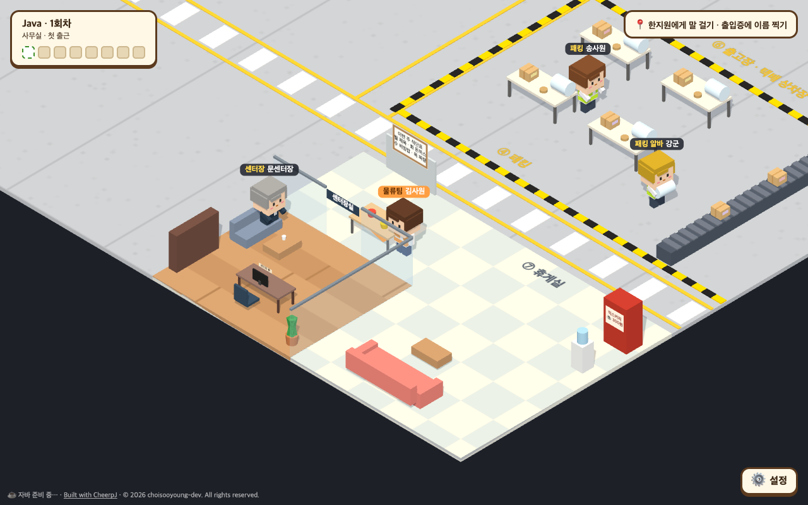

<div align="center">

# cotudy

### Clock in at a logistics center. Get the work done in code.

A 3D game for learning the basics of **Java · JavaScript · Python** with real code

[**▶ Play now**](https://choisooyoung-dev.github.io/cotudy/) &nbsp;·&nbsp; [한국어](README.md)

No install, no sign-up &nbsp;|&nbsp; Real compiling and running in your browser &nbsp;|&nbsp; Free



</div>

---

## What it is

You're **Kim**, the newest hire on the logistics team at a cosmetics fulfillment center. The receiving lead needs boxes counted, the forklift driver wants a load calculator, and the director wants an end-of-day report.
Solve your coworkers' requests **in code**, and by the end you'll have used the fundamentals of a language, from variables all the way to classes.

<table>
<tr>
<td width="50%"></td>
<td width="50%"></td>
</tr>
<tr>
<td align="center">Write code, run it, get graded instantly</td>
<td align="center">A 3D center to walk around, full of coworkers</td>
</tr>
</table>

## Features

- **Real code, really run** &nbsp; No fake multiple choice. Your code is actually compiled and run in the browser, and graded on its real output.
- **A language's basics, start to finish** &nbsp; Output, variables, conditions, loops, arrays, strings, functions, maps, classes and error handling. **29 quests** per language.
- **Four steps that make it stick** &nbsp; Read the concept → predict the output → fill in the blanks → write it yourself. Friendly for first-time coders.
- **HQ coding tests** &nbsp; Three HQ staff (easy, medium, hard) take turns visiting once a week with a problem. Ones you miss go on the break room retry board.
- **Plays on phones too** &nbsp; Walk with on-screen arrows, and one tap on "Go there" takes you to whoever you need.
- **Errors in plain words** &nbsp; When something breaks, you're told which line and why, in plain language.
- **Three languages** &nbsp; Pick Java, JavaScript or Python. Progress is saved separately for each.
- **English / 한국어** &nbsp; Dialogue, quests and even the text inside the code switch language.
- **Pick up anywhere** &nbsp; Progress saves in your browser automatically, and a save file moves it to another computer.

## What you'll learn

Each area of the center teaches one topic, and they open in order.

| # | Area | Who asks | Topics |
|:-:|---|---|---|
| 1 | Office | Jiwon (HR) | Printing, reading error messages, comments |
| 2 | Cosmetics receiving | Park | Variables, number/boolean/text types, casting |
| 3 | Order printing | Lee | Arithmetic and remainder, comparison and logic |
| 4 | Picking | Jung | if / else if, combining conditions, string comparison, switch · match |
| 5 | Packing | Song | for, while, break / continue, nested loops |
| 6 | Shipping | Oh | Arrays and lists, max and counting, growing lists |
| 7 | Courier loading | Mr. Yoon | Slicing, searching, replacing and splitting strings, formatting |
| 8 | Forklift lane | Choi | Methods and functions, parameters, return values |
| 9 | Packing bench | Kang | Maps and dictionaries (key-value), counting |
| 10 | Director's office | Director Moon | Classes and objects, error handling, final review |

## How to play

1. Pick the language you'll work in.
2. Follow Jiwon around the center and meet the team. Walk with the arrow keys (or WASD).
3. Go to anyone with a red **!** above their head and press `Space` to hear their request.
4. Write code in the mission window and press ▶ Run. Matching output means success. Fewer hints, more stars.

> **Java needs a one-time warm-up.** The first time, downloading the in-browser Java engine takes about 10–40 seconds; after that it runs instantly. You'll be on your first-day tour meanwhile.

---

## Copyright

© 2026 choisooyoung-dev. All rights reserved.

You're welcome to play and learn. Copying, modifying, redistributing or commercially using the code, quest content, characters, dialogue or visual design without permission is not allowed. If there's something you'd like to use, please ask in an issue first.
See [LICENSE](LICENSE). Third-party software (CheerpJ, Pyodide, Three.js, OpenJDK javac and more) follows its own licenses, listed in [THIRD_PARTY_NOTICES.md](THIRD_PARTY_NOTICES.md).

<details>
<summary><b>For developers: running locally and code layout</b></summary>

Requires Node.js 20 or later.

```bash
git clone https://github.com/choisooyoung-dev/cotudy.git
cd cotudy
npm install
npm run dev
```

Opens at http://localhost:5180. Pushing to `main` deploys to GitHub Pages via GitHub Actions.

- `src/main.js` game flow (language pick, dialogue, quests, first-day tour, settings)
- `src/world/` the Three.js center, characters and camera
- `src/ui/mission.js` the mission window
- `src/runner/` runners: CheerpJ for Java, Pyodide for Python, a Web Worker for JavaScript
- `src/content/<language>/` quest data. `quests.js` (Korean) and `quests.en.js` (English) cover areas 1–2; `more.js` covers areas 3–10 with both languages via `t('한국어', 'English')`
- `src/content/stages.js`, `npcs.js`, `tour.js` area order, characters, first-day tour
- `src/i18n.js` display language; on-screen text is written as `tr('한국어', 'English')`
- `public/tools.jar` javac running in the browser (Eclipse Temurin OpenJDK 8u512)
- `public/cotudy-runner-1.jar` a small helper that keeps javac loaded between runs ([source](src/runner/java-helper/cotudy/Runner.java))

Add quests to all three languages with the same `id`, `stage` and `npc`. The solution code must produce exactly `expected` when run, and explanations use only that language's terms.
While developing, open a quest straight from the browser console, e.g. `cotudy.startQuest(cotudy.current.java[0])`.

</details>
