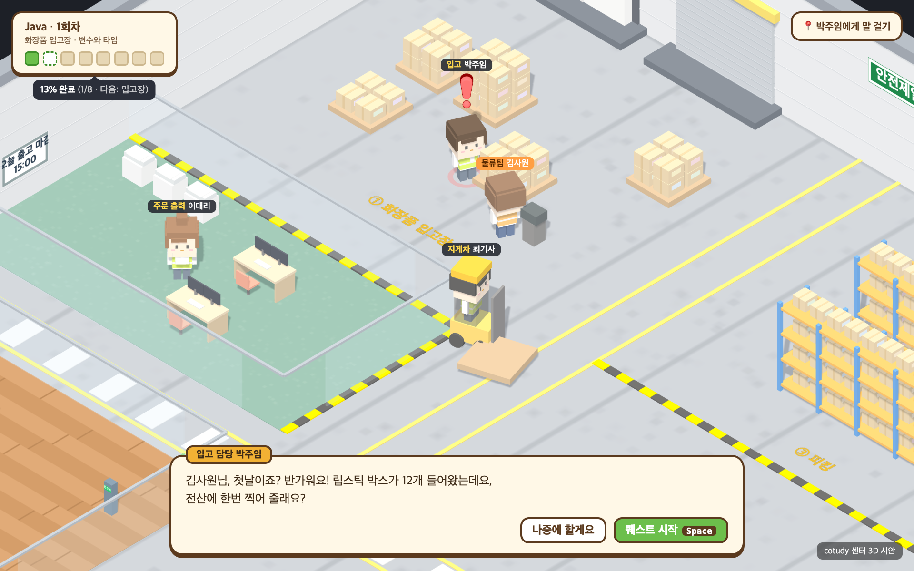

# cotudy — 물류센터에서 배우는 자바

> 화장품 물류센터 물류팀에 갓 입사한 **김사원**이 되어,
> 센터 사람들이 부탁하는 일을 **자바 코드로** 해결하는 3D 공부 게임

**▶ 바로 하기: https://choisooyoung-dev.github.io/cotudy/**

설치할 것 없이 크롬·엣지·사파리 같은 브라우저에서 열면 된다. 쓴 코드는 브라우저 안에서 **진짜로 컴파일하고 실행해서** 채점한다.



---

## 이런 걸 배워요

자바를 처음 보는 사람도 할 수 있게, 출력 한 줄부터 시작한다.

| 공간 | 담당 | 배우는 것 | 상태 |
|---|---|---|---|
| 사무실 | 인사팀 한지원 | 화면에 출력하기, 에러 메시지 읽기, 주석 | ✅ |
| 화장품 입고장 | 입고 담당 박주임 | 변수와 타입 (`int`, `long`, `double`, `boolean`, `char`, `String`, 형변환) | ✅ |
| 주문 출력실 | 출력 담당 이대리 | 연산자 | 🚧 준비 중 |
| 피킹 | 피커 정사원 | 조건문 | 🚧 |
| 패킹 | 패커 송사원 | 반복문 | 🚧 |
| 출고장 | 출고 담당 오팀원 | 배열 | 🚧 |
| 택배 상차장 | 번개택배 윤기사님 | String | 🚧 |
| 휴게실 | 문센터장 | 복습 | 🚧 |

## 하는 법

1. 처음 들어가면 인사팀 한지원이 **어떤 언어로 일할지** 물어본다. 지금은 Java 만 고를 수 있다.
2. **방향키**(또는 `W` `A` `S` `D`)로 센터를 걸어 다닌다. 휴대폰에서는 화면 왼쪽 아래 버튼을 쓴다.
3. 머리 위에 **빨간 느낌표(!)** 가 뜬 사람에게 가서 `Space` 를 누르면 부탁을 들을 수 있다. 주황 화살표가 그 사람 쪽을 가리킨다.
4. **퀘스트 시작**을 누르면 미션 창이 열린다. 순서는 이렇다.
   - **개념 공부**: 짧은 설명과 예제. `▶ 실행해 보기`로 진짜 실행 결과를 본다.
   - **출력 예상**: 코드를 보고 결과를 고른다.
   - **빈칸 채우기**: 빈칸을 채우고 실행한다.
   - **직접 쓰기**: 처음부터 직접 쓰고 실행한다. 출력이 맞으면 성공!
5. 막히면 **힌트**를 하나씩 열 수 있다. **정답 보기**는 3번 틀리면 열린다. 힌트를 안 쓸수록 별(★)을 많이 받는다.
6. 한 공간의 퀘스트를 다 끝내면 다음 공간의 노란 테이프가 걷힌다.

> ☕ **처음 실행은 조금 느려요.** 자바 실행기를 받느라 처음 한 번은 10~40초쯤 걸린다. 왼쪽 아래에 "☕ 자바 준비 완료"가 뜨면, 그다음부터는 1~2초면 실행된다. 인터넷 연결이 필요하다.

## 진행 상황 저장

- 진행 상황(끝낸 퀘스트, 별, 캐릭터 위치)은 **지금 쓰는 브라우저에 자동으로 저장**된다. 회원가입이나 로그인은 없다.
- 사람마다, 브라우저마다 따로 저장된다. 그래서 각자 자기 컴퓨터에서 이어서 하면 된다.
- **다른 컴퓨터에서 이어 하려면**: 오른쪽 아래 ⚙︎ → **💾 저장 파일 받기** → 그 파일을 다른 컴퓨터로 옮긴다 → 거기서 ⚙︎ → **📂 저장 파일 불러오기**.
- 브라우저 방문 기록·사이트 데이터를 지우거나 시크릿 창으로 하면 저장이 사라진다. 중요하면 저장 파일을 받아 두자.
- 미션 창 안에서 하던 퀘스트는 끝내야 저장된다. 중간에 나가면 그 퀘스트는 처음부터 다시 한다.

## 자주 묻는 것

- **실행을 눌렀는데 한참 "실행 중…"이에요.** 처음 한 번은 자바 실행기를 받는 중이다. 조금만 기다리자. 계속 멈춰 있으면 새로고침한다.
- **에러가 났어요.** 출력 칸 오른쪽에 "쉬운 말로" 풀이가 나온다. 빨갛게 칠해진 줄부터 보자.
- **출력이 똑같아 보이는데 틀렸대요.** 띄어쓰기, 콜론(`:`), 단위(`개`, `kg`)까지 한 글자씩 비교해 보자.
- **처음부터 다시 하고 싶어요.** ⚙︎ → 진행 초기화. (되돌릴 수 없으니 먼저 저장 파일을 받아 두자.)

---

## 저작권

**© 2026 choisooyoung-dev. All rights reserved.**

cotudy 의 코드, 퀘스트·이야기·캐릭터·대사, 화면 디자인과 그림은 모두 저작권자의 것이다.

- ✅ 위 사이트에서 **개인 공부용으로 플레이**하는 것은 자유롭게 해도 된다.
- ❌ 저작권자의 허락 없이 코드·퀘스트 내용·디자인을 **복사, 수정, 다시 배포, 다른 서비스에 사용, 상업적으로 이용**할 수 없다.
- 쓰고 싶은 부분이 있으면 GitHub 이슈로 먼저 물어봐 주세요.

자세한 내용은 [LICENSE](LICENSE). cotudy 가 함께 쓰는 외부 소프트웨어(CheerpJ, Three.js, javac)는 각자의 라이선스를 따른다 → [THIRD_PARTY_NOTICES.md](THIRD_PARTY_NOTICES.md).

---

## 개발자용

### 내 컴퓨터에서 실행

Node.js 20 이상이 필요하다.

```bash
git clone https://github.com/choisooyoung-dev/cotudy.git
cd cotudy
npm install
npm run dev
```

브라우저에서 http://localhost:5180 을 연다. (localhost 와 위 사이트는 저장 공간이 서로 다르다.)

### 배포

`main` 에 푸시하면 `.github/workflows/deploy.yml` 이 빌드해서 GitHub Pages 에 자동 배포한다 (1~2분).

### 폴더

```
public/tools.jar            브라우저에서 돌리는 javac (JDK 8)
src/main.js                 게임 흐름: 언어 선택, 대화, 퀘스트 시작·완료, 잠금, HUD, 설정(저장 파일)
src/store.js                진행 저장 (localStorage, 언어별), 저장 파일 내보내기·불러오기
src/runner/java.js          CheerpJ 로 컴파일·실행, javac 에러를 쉬운 말로 풀이
src/world/layout.js         센터 바닥·벽·가구·표지판·충돌 상자, 공간(ZONES)과 잠금 테이프
src/world/builders.js       로우폴리 도형, 캐릭터 만들기·걷기 애니메이션
src/world/game.js           Three.js 장면, 카메라, 이동·충돌, NPC, 이름표, 느낌표
src/ui/mission.js           미션 창
src/ui/code.js              코드 하이라이트, 빈칸 코드, 코드 편집기
src/content/stages.js       1회차 공간 순서
src/content/npcs.js         NPC 이름·직함·모습·돌아다니는 범위·잡담
src/content/java/quests.js  자바 퀘스트 내용 (코드와 분리된 데이터)
docs/mockups/               디자인 시안
PLAN.md                     전체 설계
```

### 새 퀘스트·공간 추가

1. `src/content/java/quests.js` 의 `QUESTS` 에 퀘스트 객체를 하나 더 넣는다.
   - `stage`: `src/content/stages.js` 의 공간 id (예: `'printing'` = 주문 출력실 · 연산자)
   - `npc`: `src/content/npcs.js` 의 id (예: `'lee'` = 이대리)
   - `concepts`(개념 카드), `predict`(출력 예상), `fill`(빈칸 `{{0}}`), `write`(직접 쓰기)를 채운다. 코드는 `main('…')` 도우미로 `class Main` 뼈대를 씌운다.
   - `fill.solution`, `write.solution` 은 "정답 보기"에 쓰이고, 실행 결과가 `expected` 와 같아야 한다.
2. 그 공간에 퀘스트가 생기면, 앞 공간을 끝냈을 때 자동으로 열린다.
3. `npm run dev` 로 띄워서 직접 풀어 본다. 브라우저 콘솔의 `cotudy.startQuest(...)` 로 바로 열 수도 있다.
