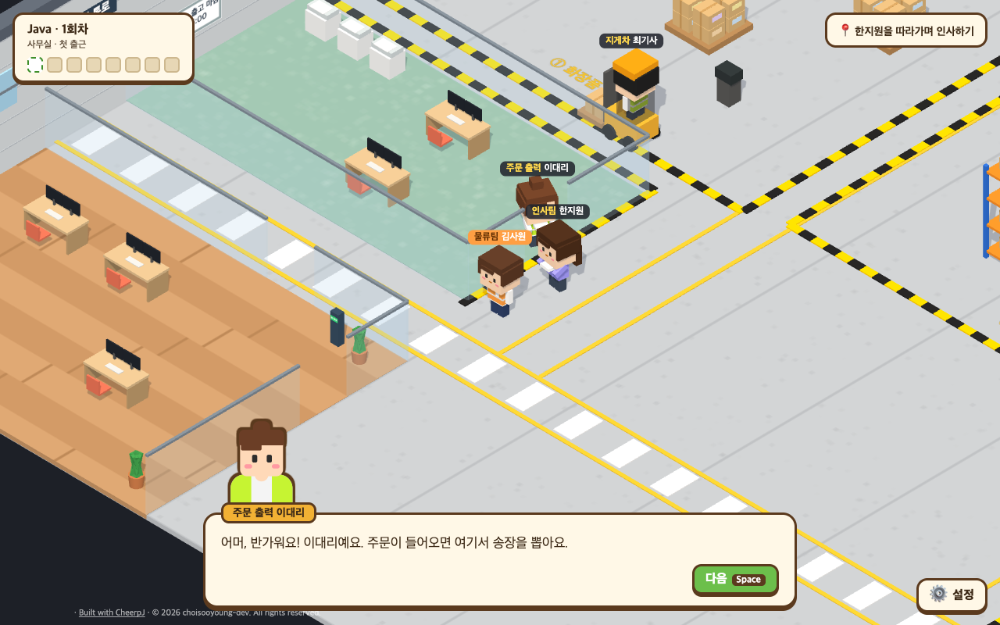
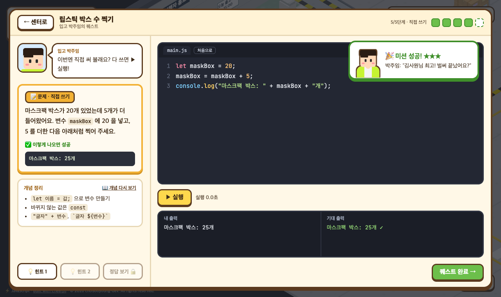
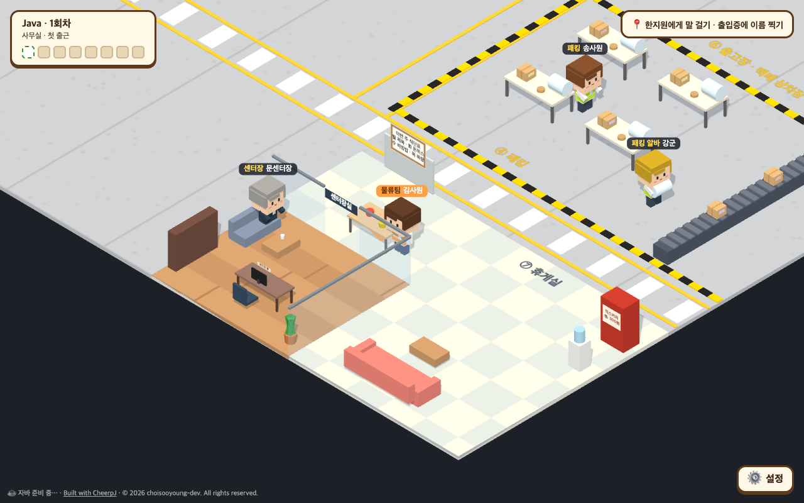

<div align="center">

# cotudy

### 물류센터에 출근해서, 코딩으로 일을 끝내는 게임

**Java · JavaScript · Python** 을 배우는 3D 코딩 학습 게임

[**▶ 지금 바로 플레이**](https://choisooyoung-dev.github.io/cotudy/) &nbsp;·&nbsp; [English](README.en.md)

설치·회원가입 없음 &nbsp;|&nbsp; 브라우저에서 바로 &nbsp;|&nbsp; 무료



</div>

---

## 이런 게임이에요

화장품 물류센터 물류팀에 들어온 **김사원**이 되어 센터를 돌아다녀요. 입고 담당은 박스 수를 세 달라고 하고, 지게차 기사님은 무게 계산기를 만들어 달라고 해요.
동료들의 부탁을 **코드로** 해결하다 보면, 한 언어의 기초부터 실무에서 자주 쓰는 문법까지 차례로 쓰게 돼요.

<table>
<tr>
<td width="50%"></td>
<td width="50%"></td>
</tr>
<tr>
<td align="center">쓴 코드를 실행해서 출력으로 채점</td>
<td align="center">돌아다니며 동료들과 대화하는 3D 센터</td>
</tr>
</table>

## 특징

- **입사 면접으로 시작** &nbsp; 본사 회의실에서 10문제 안팎의 면접을 봐요. 이미 아는 개념은 지우고, 모르는 것부터 일을 받아요. 결과는 합격 메일로 와요.
- **코드를 실행해서 채점** &nbsp; 쓴 코드를 브라우저에서 실행하고, 나온 출력이 맞는지로 채점해요.
- **4단계로 익히기** &nbsp; 개념 보기 → 출력 맞히기 → 빈칸 채우기 → 직접 쓰기. 처음 코딩하는 사람도 따라올 수 있어요.
- **기초부터 실무 문법까지** &nbsp; 언어마다 개념 39개. 출력·변수·조건·반복·배열·함수·클래스 같은 기초 29개와, 언어별 고급 개념 10개예요.
- **본사 코딩테스트** &nbsp; 첫 출근 일주일 뒤부터 본사 직원 세 명(난이도 하·중·상)이 번갈아 찾아와 문제를 내요. 못 푼 문제와 면접 문제는 휴게실 재도전 게시판에서 다시 풀 수 있어요.
- **에러는 쉬운 말로** &nbsp; 에러가 나면 몇 번째 줄이 왜 틀렸는지 우리말로 풀어 줘요.
- **캐릭터 여러 개** &nbsp; 언어마다 캐릭터를 따로 만들어 첫날부터 시작할 수 있어요. 진행은 캐릭터마다 따로 저장돼요.
- **살아 있는 센터** &nbsp; 동료들은 일하다가 가끔 휴게실에 다녀오고, 지게차를 세워 두면 직접 몰아 볼 수도 있어요.
- **휴대폰에서도** &nbsp; 바닥을 누른 채 끌면 따라 걷고, 사람이나 사물을 톡 치면 말을 걸어요. 「바로 가기」 버튼으로 찾아갈 사람 옆으로 한 번에 가요.
- **한국어 / English** &nbsp; 대사와 퀘스트, 코드 속 글자까지 영어로 바꿀 수 있어요.
- **어디서든 이어 하기** &nbsp; 진행은 브라우저에 자동 저장되고, 저장 파일로 다른 컴퓨터에 옮길 수 있어요.

## 배우는 것

1회차는 센터 공간마다 한 주제씩이에요. 세 언어 모두 같아요.

| # | 공간 | 부탁하는 사람 | 배우는 것 |
|:-:|---|---|---|
| 1 | 사무실 | 인사팀 한지원 | 화면에 출력, 에러 메시지 읽기, 주석 |
| 2 | 화장품 입고장 | 박주임 | 변수, 정수·실수·참거짓·문자열 타입, 형변환 |
| 3 | 주문 출력실 | 이대리 | 산술·나머지 연산, 비교·논리 연산 |
| 4 | 피킹 | 정사원 | if / else if, 조건 합치기, 문자열 비교, switch · match |
| 5 | 패킹 | 송사원 | for, while, break / continue, 이중 반복 |
| 6 | 출고장 | 오팀원 | 배열·리스트, 최댓값과 개수 세기, 늘어나는 리스트 |
| 7 | 택배 상차장 | 윤기사님 | 문자열 자르기·찾기·바꾸기·나누기, 서식 맞추기 |
| 8 | 지게차 통로 | 최기사 | 메서드·함수, 매개변수, 반환값 |
| 9 | 패킹 작업대 | 강군 | 맵·딕셔너리 (키-값), 개수 세기 |
| 10 | 센터장실 | 문센터장 | 클래스와 객체, 예외 처리, 종합 복습 |

그다음은 언어마다 고급 개념 10개예요.

| 언어 | 고급 개념 |
|---|---|
| Java (21) | 캡슐화, 상속, 인터페이스, static, enum, 제네릭, 컬렉션, 람다, 스트림, 직접 만든 예외 |
| JavaScript | 스코프, 클로저, 콜백, map · filter, reduce · sort, 구조 분해 · 스프레드, JSON, 상속, Promise, async / await |
| Python | 컴프리헨션, lambda · sorted, enumerate · zip, 함수 인자(*args · **kwargs), 클로저, 데코레이터, 제너레이터, 상속, 특별 메서드, 예외 만들기 · with |

## 플레이 방법

1. 캐릭터를 만들면 본사 면접부터 시작해요. 면접 볼 언어를 고르고, 아는 만큼 문제를 풀어요. 처음이라면 "기초부터"를 골라도 돼요.
2. 합격 메일을 받으면 출근! 한지원 씨를 따라 센터를 돌며 동료들과 인사해요.
3. 머리 위에 빨간 **!** 가 뜬 사람에게 가서 말을 걸면 부탁을 들을 수 있어요.
4. 미션 창에서 코드를 쓰고 ▶ 실행. 출력이 맞으면 성공이에요. 힌트를 덜 쓸수록 별을 많이 받아요.

| | 컴퓨터 | 휴대폰 |
|---|---|---|
| 걷기 | 방향키 또는 WASD | 바닥을 누른 채 끌기 (톡 치면 그 자리로) |
| 말 걸기 · 사물 쓰기 | `Enter` 또는 `Space` | 사람·사물을 톡, 또는 오른쪽 아래 버튼 |
| 대화 선택지 | 방향키로 고르고 `Enter` · `Space` | 버튼 누르기 |

> **Java 는 처음 한 번 준비가 필요해요.** 브라우저에서 자바를 돌리는 프로그램을 받아 오느라 처음엔 10~40초쯤 걸려요. 개념 예제는 그동안에도 바로 볼 수 있고, 다음부터는 금방 준비돼요.

---

## 저작권

© 2026 choisooyoung-dev. All rights reserved.

플레이하며 공부하는 건 자유예요. 코드, 퀘스트 내용, 캐릭터와 대사, 화면 디자인을 허락 없이 복사·수정·재배포하거나 상업적으로 쓰는 건 안 돼요. 쓰고 싶은 부분이 있으면 이슈로 먼저 물어봐 주세요.
자세한 건 [LICENSE](LICENSE), 함께 쓰는 외부 프로그램(CheerpJ, Pyodide, Three.js 등)의 라이선스는 [THIRD_PARTY_NOTICES.md](THIRD_PARTY_NOTICES.md) 에 있어요.

<details>
<summary><b>개발자용: 직접 띄우기와 코드 구조</b></summary>

Node.js 20 이상이 필요해요.

```bash
git clone https://github.com/choisooyoung-dev/cotudy.git
cd cotudy
npm install
npm run dev
```

http://localhost:5180 으로 열려요. `main` 에 푸시하면 GitHub Actions 가 GitHub Pages 에 배포해요.
코드 정리는 `npm run format` (Prettier, 들여쓰기 4칸).

**코드 구조**

- `src/main.js` 게임 흐름: 대화창, 퀘스트, 첫 출근 투어, 입사 면접, 본사 직원 방문, 재도전 게시판, 설정
- `src/world/` Three.js 로 만든 물류센터, 캐릭터, 카메라, 사람들의 움직임
- `src/ui/mission.js` 미션 창 · `src/ui/hire.js` 입사 면접과 합격 메일
- `src/runner/` 언어별 실행기: Java 는 CheerpJ(Java 21), Python 은 Pyodide, JavaScript 는 Web Worker
- `src/store.js` 저장 (캐릭터마다, 언어마다)
- `src/content/<언어>/` 퀘스트 데이터. `quests.js`·`quests.en.js` 는 1~2번 공간, `more.js` 는 3~10번 공간, `advanced.js` 는 고급 개념, `interview.js` 는 면접 종합 문제, `hq.js` 는 본사 문제
- `src/content/stages.js`, `npcs.js`, `tour.js` 단계 순서, 등장인물, 첫 출근 투어
- `src/i18n.js` 화면 언어. 화면 글자는 `tr('한국어', 'English')` 로 써요
- `public/java-frame.html` 자바를 돌리는 숨은 창. CheerpJ 의 javac 가 한 페이지에서 68번째 컴파일에 멈춰서, 50번마다 새 창으로 바꿔요
- `src/content/outputs.json` Java·Python 예제와 정답 코드를 미리 실행해 둔 결과. 같은 코드는 실행하지 않고 이 결과를 보여 줘요

**퀘스트를 고쳤을 때**

```bash
node scripts/precompute-outputs.mjs        # 예제·정답 코드 결과를 다시 만들기 (npm run dev 를 켠 상태에서)
node scripts/daily-check.mjs http://localhost:5180/   # 모든 퀘스트 코드를 실행해서 기대 출력과 비교
```

퀘스트는 세 언어 모두 같은 `id`, `stage`, `npc` 로 넣어요. 정답 코드를 실행했을 때 `expected` 와 똑같이 나와야 하고, 설명은 그 언어만으로 써요.
개발 중에는 브라우저 콘솔에서 `cotudy.startQuest(cotudy.current.java[0])` 처럼 퀘스트를 바로 열 수 있어요.

</details>
