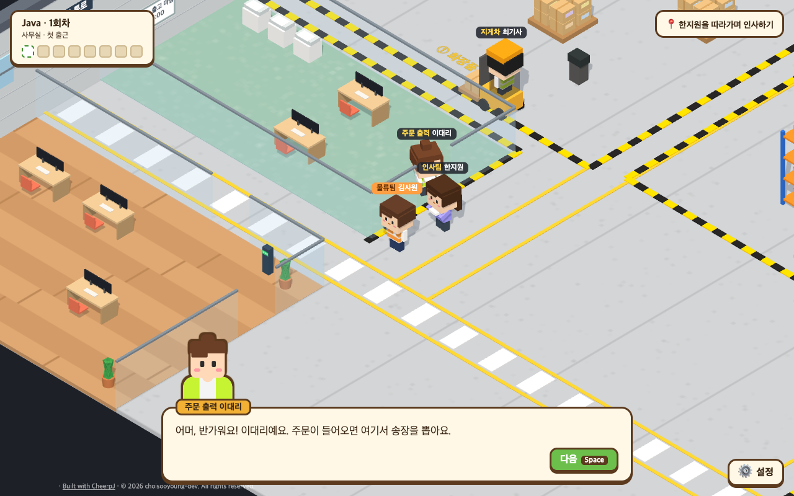
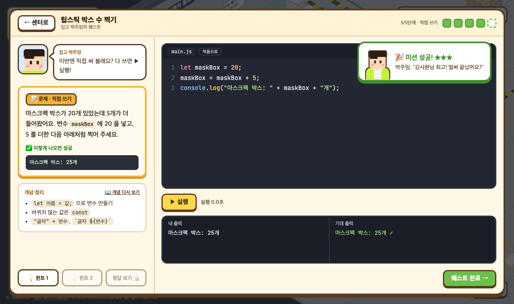
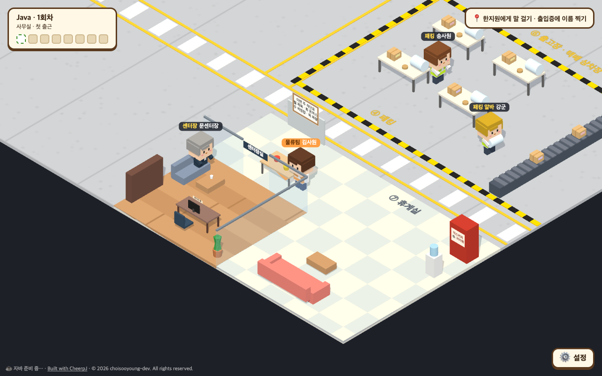

<div align="center">

# cotudy

### 물류센터에 출근해서, 코딩으로 일을 끝내는 게임

**Java · JavaScript · Python** 기초를 진짜 코드로 배우는 3D 코딩 학습 게임

[**▶ 지금 바로 플레이**](https://choisooyoung-dev.github.io/cotudy/) &nbsp;·&nbsp; [English](README.en.md)

설치·회원가입 없음 &nbsp;|&nbsp; 브라우저에서 진짜 컴파일·실행 &nbsp;|&nbsp; 무료



</div>

---

## 이런 게임이에요

화장품 물류센터 물류팀에 갓 입사한 **김사원**이 되어 센터를 돌아다녀요. 입고 담당은 박스 수를 세 달라고 하고, 지게차 기사님은 무게 계산기를 만들어 달라고 해요.
동료들의 부탁을 **코드로** 해결하다 보면, 어느새 변수부터 클래스까지 한 언어의 기초를 다 쓰게 돼요.

<table>
<tr>
<td width="50%"></td>
<td width="50%"></td>
</tr>
<tr>
<td align="center">쓴 코드를 바로 실행해서 채점</td>
<td align="center">돌아다니며 동료들과 대화하는 3D 센터</td>
</tr>
</table>

## 특징

- **진짜 코드, 진짜 실행** &nbsp; 객관식 흉내가 아니에요. 쓴 코드를 브라우저 안에서 실제로 컴파일하고 실행해서, 나온 출력으로 채점해요.
- **한 언어의 기초를 끝까지** &nbsp; 출력부터 변수, 조건문, 반복문, 배열, 문자열, 함수, 맵, 클래스, 예외 처리까지. 언어마다 **29개 퀘스트**.
- **4단계로 몸에 붙게** &nbsp; 개념 보기 → 출력 맞히기 → 빈칸 채우기 → 직접 쓰기. 처음 코딩하는 사람도 따라올 수 있어요.
- **본사 코딩테스트** &nbsp; 본사 직원 세 명(난이도 하·중·상)이 일주일에 한 번 번갈아 찾아와 문제를 내요. 못 푼 문제는 휴게실 재도전 게시판에서 다시 풀 수 있어요.
- **모바일에서도** &nbsp; 화면 방향키로 걷고, "바로 가기" 버튼 한 번이면 찾아갈 사람 옆으로 이동해요.
- **에러도 쉬운 말로** &nbsp; 컴파일 에러가 나면 몇 번째 줄이 왜 틀렸는지 우리말로 풀어 줘요.
- **세 가지 언어** &nbsp; Java, JavaScript, Python 중 하나를 골라요. 언어마다 진행이 따로 저장돼요.
- **한국어 / English** &nbsp; 대사와 퀘스트, 코드 속 글자까지 영어로 바꿀 수 있어요.
- **어디서든 이어 하기** &nbsp; 진행은 브라우저에 자동 저장되고, 저장 파일로 다른 컴퓨터에 옮길 수 있어요.

## 배우는 것

센터 공간마다 한 주제씩, 순서대로 열려요.

| # | 공간 | 부탁하는 사람 | 배우는 것 |
|:-:|---|---|---|
| 1 | 사무실 | 인사팀 한지원 | 화면에 출력, 에러 메시지 읽기, 주석 |
| 2 | 화장품 입고장 | 박주임 | 변수, 정수·실수·참거짓·문자열 타입, 형변환 |
| 3 | 주문 출력실 | 이대리 | 산술·나머지 연산, 비교·논리 연산 |
| 4 | 피킹 | 정사원 | if / else if, 조건 합치기, 문자열 비교, switch · match |
| 5 | 패킹 | 송사원 | for, while, break / continue, 이중 반복 |
| 6 | 출고장 | 오팀원 | 배열·리스트, 최댓값과 개수 세기, 늘어나는 리스트 |
| 7 | 택배 상차장 | 윤기사님 | 문자열 자르기·찾기·바꾸기·나누기, 서식 맞추기 |
| 8 | 지게차 통로 | 최기사 | 메서드·함수, 매개변수, 반환값 |
| 9 | 패킹 작업대 | 강군 | 맵·딕셔너리 (키-값), 개수 세기 |
| 10 | 센터장실 | 문센터장 | 클래스와 객체, 예외 처리, 종합 복습 |

## 플레이 방법

1. 처음 들어가면 일할 언어를 골라요.
2. 한지원 씨를 따라 센터를 돌며 동료들과 인사해요. 방향키(또는 WASD)로 걸어요.
3. 머리 위에 빨간 **!** 가 뜬 사람에게 가서 `Space` 를 누르면 부탁을 들을 수 있어요.
4. 미션 창에서 코드를 쓰고 ▶ 실행. 출력이 맞으면 성공이에요. 힌트를 덜 쓸수록 별을 많이 받아요.

> **Java 는 처음 한 번 준비가 필요해요.** 브라우저에서 자바를 돌리는 프로그램을 받아 오느라 처음엔 10~40초쯤 걸리고, 그다음부터는 바로 실행돼요. 그동안은 첫 출근 투어를 하고 있으면 돼요.

---

## 저작권

© 2026 choisooyoung-dev. All rights reserved.

플레이하며 공부하는 건 자유예요. 코드, 퀘스트 내용, 캐릭터와 대사, 화면 디자인을 허락 없이 복사·수정·재배포하거나 상업적으로 쓰는 건 안 돼요. 쓰고 싶은 부분이 있으면 이슈로 먼저 물어봐 주세요.
자세한 건 [LICENSE](LICENSE), 함께 쓰는 외부 프로그램(CheerpJ, Pyodide, Three.js, OpenJDK javac 등)의 라이선스는 [THIRD_PARTY_NOTICES.md](THIRD_PARTY_NOTICES.md) 에 있어요.

<details>
<summary><b>개발자용: 직접 띄우기와 코드 구조</b></summary>

Node.js 20 이상이 필요해요.

```bash
git clone https://github.com/choisooyoung-dev/cotudy.git
cd cotudy
npm install
npm run dev
```

http://localhost:5180 으로 열려요. `main` 에 푸시하면 GitHub Actions 가 GitHub Pages 에 배포해요.

- `src/main.js` 게임 흐름 (언어 선택, 대화, 퀘스트, 첫 출근 투어, 설정)
- `src/world/` Three.js 로 만든 물류센터, 캐릭터, 카메라
- `src/ui/mission.js` 미션 창
- `src/runner/` 언어별 실행기: Java 는 CheerpJ, Python 은 Pyodide, JavaScript 는 Web Worker
- `src/content/<언어>/` 퀘스트 데이터. `quests.js`(한국어)·`quests.en.js`(영어)는 1~2번 공간, `more.js` 는 3~10번 공간(한·영을 `t('한국어', 'English')` 로 함께)
- `src/content/stages.js`, `npcs.js`, `tour.js` 공간 순서, 등장인물, 첫 출근 투어
- `src/i18n.js` 화면 언어. 화면 글자는 `tr('한국어', 'English')` 로 써요
- `public/tools.jar` 브라우저에서 돌리는 javac (Eclipse Temurin OpenJDK 8u512)
- `public/cotudy-runner-1.jar` javac 를 한 번만 띄워 두고 계속 쓰게 해 주는 도우미 ([소스](src/runner/java-helper/cotudy/Runner.java))

퀘스트는 세 언어 모두 같은 `id`, `stage`, `npc` 로 넣어요. 정답 코드를 실제로 돌렸을 때 `expected` 와 똑같이 나와야 하고, 설명은 그 언어만으로 써요.
개발 중에는 브라우저 콘솔에서 `cotudy.startQuest(cotudy.current.java[0])` 처럼 퀘스트를 바로 열 수 있어요.

</details>
